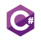
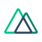
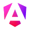
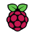
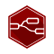
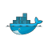
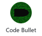
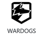
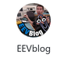

<a href="https://github.com/Tolkium">
  <picture>
    <source media="(prefers-color-scheme: dark)" srcset="./dark_mode.svg">
    
  </picture>
</a>

### ⚡ Featured Projects <picture><source media="(prefers-color-scheme: dark)" srcset="./assets/line-dark.svg"></picture>

  
  
  
  

### 🧬 Activity <picture><source media="(prefers-color-scheme: dark)" srcset="./assets/line-dark.svg"></picture>

### 🧰 Tech Stack <picture><source media="(prefers-color-scheme: dark)" srcset="./assets/line-dark.svg"></picture>

<a href="https://soliditylang.org/"><picture><source media="(prefers-color-scheme: dark)" srcset="./assets/tech/icons/solidity-dark.png"></picture></a><a href="https://nextjs.org/"><picture><source media="(prefers-color-scheme: dark)" srcset="./assets/tech/icons/next-js-dark.png"></picture></a><a href="https://expressjs.com/"><picture><source media="(prefers-color-scheme: dark)" srcset="./assets/tech/icons/express-dark.png"></picture></a><a href="https://developer.mozilla.org/docs/Web/API/WebSockets_API"><picture><source media="(prefers-color-scheme: dark)" srcset="./assets/tech/icons/websockets-dark.png"></picture></a><a href="https://unity.com/"><picture><source media="(prefers-color-scheme: dark)" srcset="./assets/tech/icons/unity-dark.png"></picture></a><a href="https://vercel.com/"><picture><source media="(prefers-color-scheme: dark)" srcset="./assets/tech/icons/vercel-dark.png"></picture></a><a href="https://pages.github.com/"><picture><source media="(prefers-color-scheme: dark)" srcset="./assets/tech/icons/github-pages-dark.png"></picture></a><a href="https://ollama.com/"><picture><source media="(prefers-color-scheme: dark)" srcset="./assets/tech/icons/ollama-dark.png"></picture></a>

### 🎧 Hobbies <picture><source media="(prefers-color-scheme: dark)" srcset="./assets/line-dark.svg"></picture>

<picture><source media="(prefers-color-scheme: dark)" srcset="./assets/hobbies/title-creators-dark.png"></picture><picture><source media="(max-width: 1199px)" srcset="./assets/hobbies/blank.png"><source media="(prefers-color-scheme: dark)" srcset="./assets/hobbies/gap-dark.png"></picture><picture><source media="(max-width: 1199px)" srcset="./assets/hobbies/blank.png"><source media="(prefers-color-scheme: dark)" srcset="./assets/hobbies/title-games-dark.png"></picture> 
<a href="https://www.youtube.com/@davepl"><picture><source media="(prefers-color-scheme: dark)" srcset="./assets/hobbies/davepl-dark.png"></picture></a><a href="https://www.youtube.com/@LowLevelTV"><picture><source media="(prefers-color-scheme: dark)" srcset="./assets/hobbies/lowleveltv-dark.png"></picture></a><a href="https://www.youtube.com/@ThePrimeTimeagen"><picture><source media="(prefers-color-scheme: dark)" srcset="./assets/hobbies/theprimetimeagen-dark.png"></picture></a><a href="https://www.youtube.com/@t3dotgg"><picture><source media="(prefers-color-scheme: dark)" srcset="./assets/hobbies/t3dotgg-dark.png"></picture></a><a href="https://www.youtube.com/@Fireship"><picture><source media="(prefers-color-scheme: dark)" srcset="./assets/hobbies/fireship-dark.png"></picture></a><a href="https://www.youtube.com/@CodeBullet"><picture><source media="(prefers-color-scheme: dark)" srcset="./assets/hobbies/codebullet-dark.png"></picture></a><picture><source media="(max-width: 1199px)" srcset="./assets/hobbies/blank.png"><source media="(prefers-color-scheme: dark)" srcset="./assets/hobbies/gap-dark.png"></picture><a href="https://store.steampowered.com/app/2073850/"><picture><source media="(max-width: 1199px)" srcset="./assets/hobbies/blank.png"><source media="(prefers-color-scheme: dark)" srcset="./assets/hobbies/the-finals-dark.png"></picture></a><a href="https://store.steampowered.com/app/1867240/"><picture><source media="(max-width: 1199px)" srcset="./assets/hobbies/blank.png"><source media="(prefers-color-scheme: dark)" srcset="./assets/hobbies/wardogs-dark.png"></picture></a><a href="https://store.steampowered.com/app/1623730/"><picture><source media="(max-width: 1199px)" srcset="./assets/hobbies/blank.png"><source media="(prefers-color-scheme: dark)" srcset="./assets/hobbies/palworld-dark.png"></picture></a> 
<a href="https://www.youtube.com/@willjum"><picture><source media="(prefers-color-scheme: dark)" srcset="./assets/hobbies/willjum-dark.png"></picture></a><a href="https://www.youtube.com/@GamerMeld"><picture><source media="(prefers-color-scheme: dark)" srcset="./assets/hobbies/gamermeld-dark.png"></picture></a><a href="https://www.youtube.com/@EEVblog"><picture><source media="(prefers-color-scheme: dark)" srcset="./assets/hobbies/eevblog-dark.png"></picture></a><a href="https://www.youtube.com/@JerryRigEverything"><picture><source media="(prefers-color-scheme: dark)" srcset="./assets/hobbies/jerryrigeverything-dark.png"></picture></a><a href="https://www.youtube.com/@LinusTechTips"><picture><source media="(prefers-color-scheme: dark)" srcset="./assets/hobbies/linustechtips-dark.png"></picture></a><a href="https://www.youtube.com/@MarkRober"><picture><source media="(prefers-color-scheme: dark)" srcset="./assets/hobbies/markrober-dark.png"></picture></a> 
<picture><source media="(min-width: 1200px)" srcset="./assets/hobbies/blank.png"><source media="(prefers-color-scheme: dark)" srcset="./assets/hobbies/title-games-dark.png"></picture><a href="https://store.steampowered.com/app/2073850/"><picture><source media="(min-width: 1200px)" srcset="./assets/hobbies/blank.png"><source media="(prefers-color-scheme: dark)" srcset="./assets/hobbies/the-finals-dark.png"></picture></a><a href="https://store.steampowered.com/app/1867240/"><picture><source media="(min-width: 1200px)" srcset="./assets/hobbies/blank.png"><source media="(prefers-color-scheme: dark)" srcset="./assets/hobbies/wardogs-dark.png"></picture></a><a href="https://store.steampowered.com/app/1623730/"><picture><source media="(min-width: 1200px)" srcset="./assets/hobbies/blank.png"><source media="(prefers-color-scheme: dark)" srcset="./assets/hobbies/palworld-dark.png"></picture></a>

