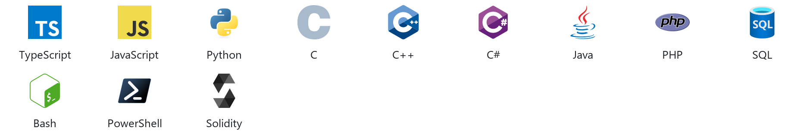
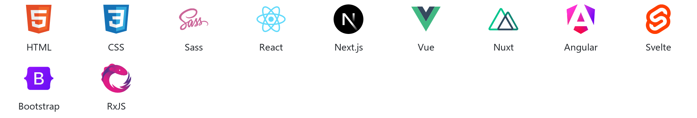
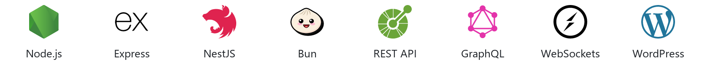
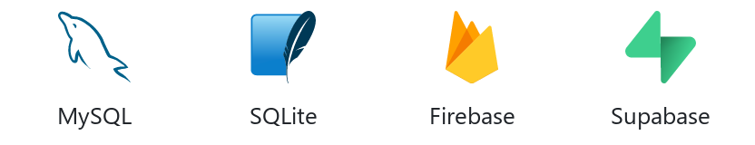
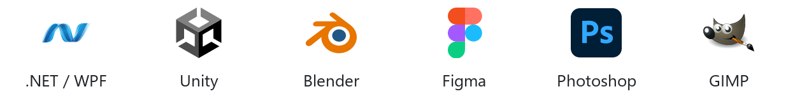
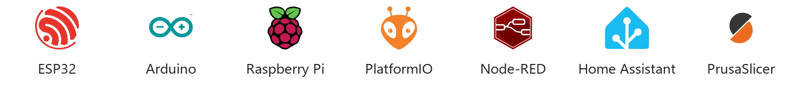
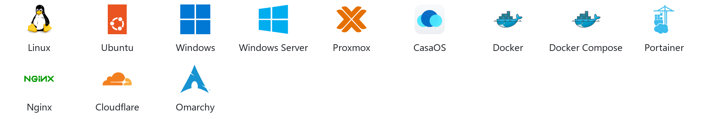
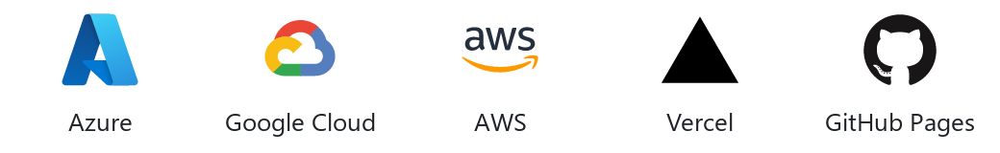
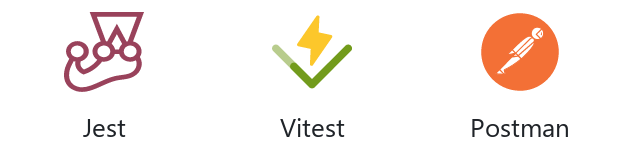
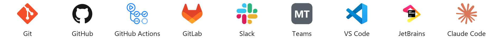

<a href="https://github.com/Tolkium">
  <picture>
    <source media="(prefers-color-scheme: dark)" srcset="./dark_mode.svg">
    
  </picture>
</a>

### ⚡ Featured Projects <picture><source media="(prefers-color-scheme: dark)" srcset="./assets/line-dark.svg"></picture>

  
  
  
  

### 🧰 Tech Stack <picture><source media="(prefers-color-scheme: dark)" srcset="./assets/line-dark.svg"></picture>

<b>Languages</b>

<picture>
  <source media="(prefers-color-scheme: dark)" srcset="./assets/tech/languages-dark.png">
  
</picture>

<b>Frontend</b>

<picture>
  <source media="(prefers-color-scheme: dark)" srcset="./assets/tech/frontend-dark.png">
  
</picture>

<b>Backend & APIs</b>

<picture>
  <source media="(prefers-color-scheme: dark)" srcset="./assets/tech/backend-apis-dark.png">
  
</picture>

<b>Databases</b>

<picture>
  <source media="(prefers-color-scheme: dark)" srcset="./assets/tech/databases-dark.png">
  
</picture>

<b>Desktop, mobile & graphics</b>

<picture>
  <source media="(prefers-color-scheme: dark)" srcset="./assets/tech/desktop-mobile-graphics-dark.png">
  
</picture>

<b>IoT, hardware & making</b>

<picture>
  <source media="(prefers-color-scheme: dark)" srcset="./assets/tech/iot-hardware-making-dark.png">
  
</picture>

<b>Homelab, OS & infrastructure</b>

<picture>
  <source media="(prefers-color-scheme: dark)" srcset="./assets/tech/homelab-os-infrastructure-dark.png">
  
</picture>

<b>Cloud & hosting</b>

<picture>
  <source media="(prefers-color-scheme: dark)" srcset="./assets/tech/cloud-hosting-dark.png">
  
</picture>

<b>AI & data</b>

<picture>
  <source media="(prefers-color-scheme: dark)" srcset="./assets/tech/ai-data-dark.png">
  
</picture>

<b>Testing</b>

<picture>
  <source media="(prefers-color-scheme: dark)" srcset="./assets/tech/testing-dark.png">
  
</picture>

<b>Tools & workflow</b>

<picture>
  <source media="(prefers-color-scheme: dark)" srcset="./assets/tech/tools-workflow-dark.png">
  
</picture>

### 🧬 Activity <picture><source media="(prefers-color-scheme: dark)" srcset="./assets/line-dark.svg"></picture>

### 🎧 Hobbies <picture><source media="(prefers-color-scheme: dark)" srcset="./assets/line-dark.svg"></picture>

<b>📺 Favorite Creators</b>

  <picture>
    <source media="(prefers-color-scheme: dark)" srcset="./assets/creators-dark.png">
    
  </picture>

<b>🎮 Currently Playing</b>

  <picture>
    <source media="(prefers-color-scheme: dark)" srcset="./assets/games-dark.png">
    
  </picture>

