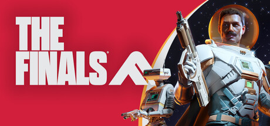
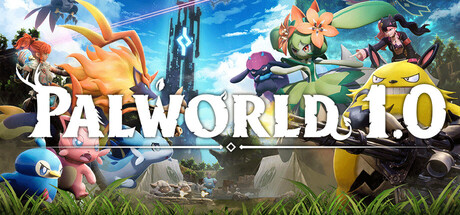

<a href="https://github.com/Tolkium">
  <picture>
    <source media="(prefers-color-scheme: dark)" srcset="./dark_mode.svg">
    
  </picture>
</a>

## ⚡ Featured Projects

<table>
  <tr>
    <td width="25%"></td>
    <td width="25%"></td>
    <td width="25%"></td>
    <td width="25%"></td>
  </tr>
</table>

## 🧬 Activity

## 🎧 Hobbies

### 📺 Favorite Creators

  
  
  
  
  
  
  
  
  
  
  

### 🎮 Games

<table>
  <tr>
    <td width="33%" align="center"> <b>THE FINALS</b></td>
    <td width="33%" align="center"> <b>WARDOGS</b></td>
    <td width="33%" align="center"> <b>Palworld</b></td>
  </tr>
</table>
