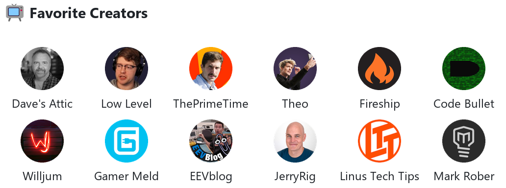
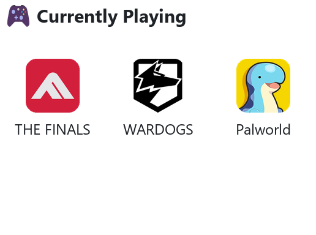

<a href="https://github.com/Tolkium">
  <picture>
    <source media="(prefers-color-scheme: dark)" srcset="./dark_mode.svg">
    
  </picture>
</a>

### ⚡ Featured Projects <picture><source media="(prefers-color-scheme: dark)" srcset="./assets/line-dark.svg"></picture>

  
  
  
  

### 🧬 Activity <picture><source media="(prefers-color-scheme: dark)" srcset="./assets/line-dark.svg"></picture>

### 🎧 Hobbies <picture><source media="(prefers-color-scheme: dark)" srcset="./assets/line-dark.svg"></picture>

<b>📺 Favorite Creators</b>

  <picture>
    <source media="(prefers-color-scheme: dark)" srcset="./assets/creators-dark.png">
    
  </picture>

<b>🎮 Currently Playing</b>

  <picture>
    <source media="(prefers-color-scheme: dark)" srcset="./assets/games-dark.png">
    
  </picture>

